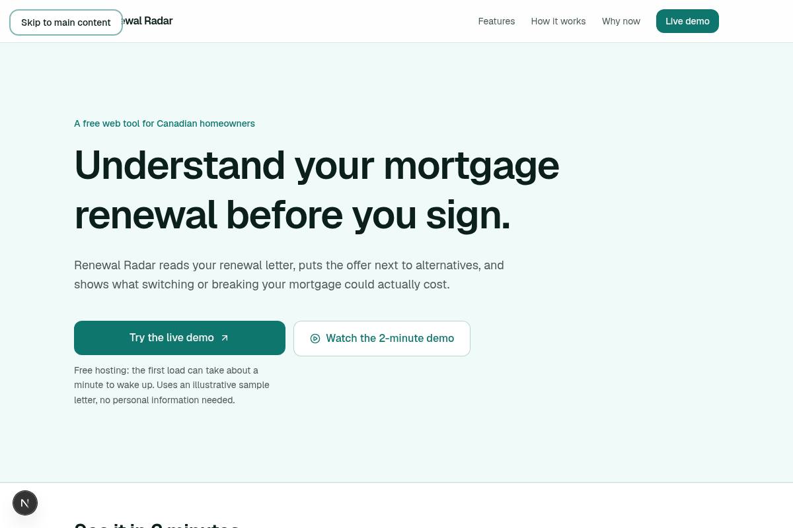

# Renewal Radar, Shipped from the Terminal


A log of taking my Renewal Radar site from GitHub to my own machine and back, using only typed commands.

Live site: https://renewal-radar-site.vercel.app
Site code: https://github.com/ALENZACODES/renewal-radar-site
The commit I pushed: https://github.com/ALENZACODES/renewal-radar-site/commit/71bed1b


## What I did
1. Checked my tools: Node 24.22.1, Git 2.47.3, pnpm 12.16.1
2. Cloned the repo with `gh repo clone`, installed with `pnpm install`, ran it with `pnpm dev` and got HTTP 200 on localhost:3000
3. Made one real change: a "Skip to main content" link for keyboard users and a "How it works" link in the header
4. Ran `pnpm build` to make sure the production build still passes
5. Committed under my own name and pushed to main
6. Installed the Vercel CLI to make a preview deployment



## Project structure

```text
renewal-radar-terminal-log/
├── images/                              # Screenshots
│   ├── commit-71bed1b.png
│   └── local-site-skip-link.png
├── transcripts/                         # Raw terminal output
│   ├── 01-clone-install-run.txt         # Tools, clone, install, local run
│   ├── 02-change-build-commit-push.txt  # Diff, build, commit, push
│   └── 03-vercel-cli.txt                # Vercel CLI install and login check
├── COMMANDS.md                          # Every command, in order, with what it does
├── cover.png                            # Cover image
└── README.md                            # This file
```

Built by John Khan, ALENZA CODES, Toronto, Ontario.
